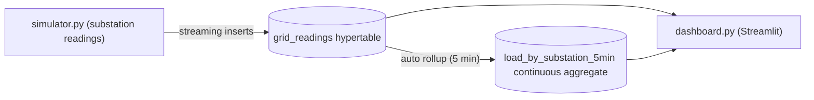

# VoltStream

Real-time power-grid telemetry on Tiger Data. A Python simulator streams load and voltage readings from four substations into a TimescaleDB hypertable on Tiger Cloud, and a Streamlit dashboard renders grid KPIs, per-minute load, per-substation rollups, and voltage trends as readings land.

Built for MLH Global Hack Week: Builders Week.

## Architecture



## How it works

**Simulator.** `simulator.py` generates one load and voltage reading per substation every 2 seconds. Demand follows a slow sine wave with per-station phase offsets plus a bounded random walk, so the charts show daily cycles rather than white noise. Voltage follows a droop model: heavier load relative to a substation's base demand pulls busbar voltage down. On a fresh database it backfills six hours of history at 10-second resolution before going live.

**Hypertable.** `grid_readings` is a TimescaleDB hypertable partitioned into 1-hour chunks. Time-range queries (`last 15 minutes`, `last hour`) only scan recent chunks, keeping dashboard query latency steady as total table size grows.

**Continuous aggregate.** `load_by_substation_5min` is a materialized view that rolls raw readings into per-substation, 5-minute load buckets (average and peak). A refresh policy runs every minute, and real-time querying includes the newest unmaterialized rows.

**Dashboard.** `dashboard.py` queries the hypertable and aggregate on a timer and re-renders without extra auto-refresh packages. Each refresh opens a short-lived connection so connection state never goes stale.

## Quick start

1. Create a free service in [Tiger Console](https://console.cloud.tigerdata.com) (or reuse an existing one) and copy its connection string.
2. Copy `.env.example` to `.env` and paste the connection string as `DATABASE_URL`.
3. Install and run:

```bash
pip install -r requirements.txt
python simulator.py        # terminal 1: streams until Ctrl+C
streamlit run dashboard.py # terminal 2: opens http://localhost:8501
```

## Configuration

| Variable       | Description                                                        |
| -------------- | ------------------------------------------------------------------ |
| `DATABASE_URL` | Tiger Cloud connection string, e.g. `postgres://tsdbadmin:.../tsdb?sslmode=require` |

## Schema

`grid_readings(ts, substation_id, load_mw, voltage_kv)` stores one row per substation reading. `sql/init.sql` contains the standalone schema statements if you prefer running them manually in Tiger Console's SQL Editor.

To reset the data and start over, run `TRUNCATE grid_readings;` and restart the simulator for a fresh backfill.

## Expense tracker CLI

The repository also includes a standalone CSV-backed expense tracker:

```bash
python expense_tracker.py
```

Use the menu to add expenses, list saved expenses, or view totals grouped by category. Expenses are stored in `expenses.csv` by default; pass a different CSV path as the first argument when needed:

```bash
python expense_tracker.py household-expenses.csv
```

## Tech stack

| Layer            | Tool                              |
| ---------------- | --------------------------------- |
| Database         | Tiger Cloud (managed TimescaleDB) |
| Ingest           | Python, psycopg 3                 |
| Dashboard        | Streamlit, Plotly                 |
| Data wrangling   | pandas                            |

## License

MIT, see [LICENSE](LICENSE).
