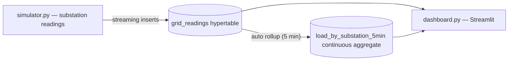

# VoltStream

Real-time power-grid telemetry on Tiger Data. A Python simulator streams
load and voltage readings from four substations into a TimescaleDB
hypertable on Tiger Cloud, and a Streamlit dashboard renders grid KPIs,
per-minute load, per-substation rollups and voltage trends as the readings
land.

Built for MLH Global Hack Week: Builders Week.

## Architecture



## How it works

**Simulator.** `simulator.py` generates one load and voltage reading per
substation every 2 seconds. Demand follows a slow sine wave with per-station
phase offsets plus a bounded random walk, so the charts show organic rushes
and lulls rather than white noise. Voltage follows a droop model — the
heavier the load relative to a substation's base demand, the lower its
busbar voltage. On a fresh database it backfills six hours of history at
10-second resolution before going live.

**Hypertable.** `grid_readings` is a TimescaleDB hypertable partitioned into
1-hour chunks. Time-range queries (`last 15 minutes`, `last hour`) only
touch recent chunks, which keeps the dashboard's queries fast regardless of
total table size — the defining property of telemetry workloads.

**Continuous aggregate.** `load_by_substation_5min` is a materialized view
that rolls raw readings into per-substation, 5-minute load buckets (average
and peak). A refresh policy maintains it every minute, and because it is
queried in realtime mode, the most recent un-materialized readings are
included too.

**Dashboard.** `dashboard.py` queries the hypertable and the aggregate on a
timer and re-renders itself — no extra auto-refresh dependencies. Each
refresh uses a short-lived connection, so there is no connection lifecycle
state to go stale.

## Quick start

1. Create a free service in [Tiger Console](https://console.cloud.tigerdata.com)
   (or reuse an existing one) and copy its connection string.
2. Copy `.env.example` to `.env` and paste the connection string as
   `DATABASE_URL`.
3. Install and run:

```bash
pip install -r requirements.txt
python simulator.py        # terminal 1 — keeps streaming until Ctrl+C
streamlit run dashboard.py # terminal 2 — opens http://localhost:8501
```

## Configuration

| Variable       | Description                                                        |
| -------------- | ------------------------------------------------------------------ |
| `DATABASE_URL` | Tiger Cloud connection string, e.g. `postgres://tsdbadmin:…/tsdb?sslmode=require` |

## Schema

`grid_readings(ts, substation_id, load_mw, voltage_kv)` — one row per
substation reading. `sql/init.sql` contains the standalone schema statements
if you prefer to run them by hand in Tiger Console's SQL Editor.

To reset the data and start over: `TRUNCATE grid_readings;` then restart the
simulator for a fresh backfill.

## Tech stack

| Layer            | Tool                              |
| ---------------- | --------------------------------- |
| Database         | Tiger Cloud (managed TimescaleDB) |
| Ingest           | Python, psycopg 3                 |
| Dashboard        | Streamlit, Plotly                 |
| Data wrangling   | pandas                            |

## License

MIT — see [LICENSE](LICENSE).
